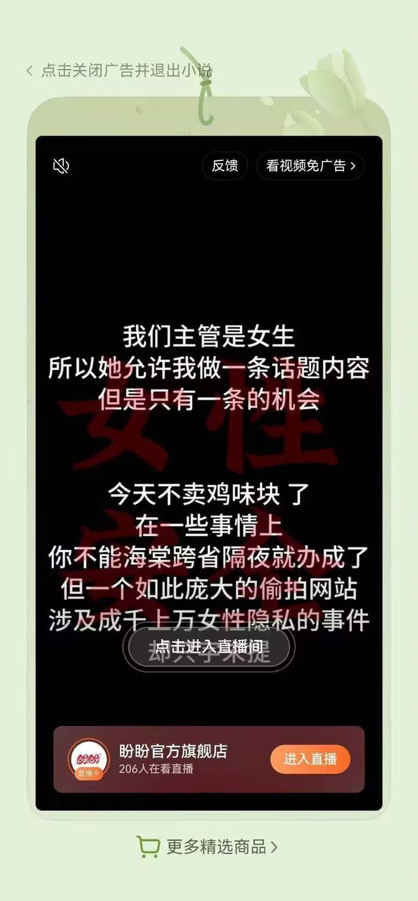
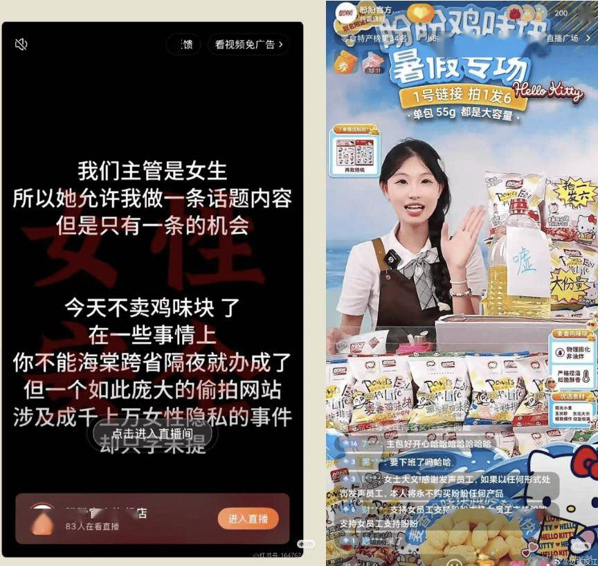
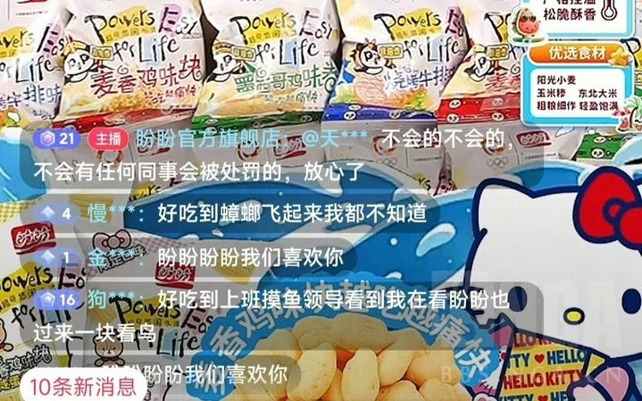

# 盼盼待审批稿

**品牌：** 盼盼  
**别名：** 盼盼食品、PANPAN  
**国家：** 中国  
**品牌分类：** 食品饮料 → 食品  
**原因分类：** 性别歧视 → 歧视男性  
**拟列入日期：** 2026年10月15日  
**事件日期：** 2025年8月7日

**事件标题**

盼盼借女权叙事卖货，用“半桶油”性羞辱男性，并拒绝处罚责任人

**事件摘要**

盼盼将违法犯罪案件海棠色情写作案件与女权编造的MaskPark偷拍话题并置，利用女权叙事为官方旗舰店直播间引流。面对批评，直播间拿出贴有“嘘”字的半桶食用油，借性交易暗梗侮辱男性质疑者。商家一边卖食品，一边把提出意见的男性往嫖客形象上套，直播间账号还承诺不会处罚同事。官方账号打拳，男性消费者花钱还要挨骂，路过的男性观众也不能幸免。女权果然没有爸爸，哦不对，那是生物爹。

**事件详情**

2025年8月7日，公开传播的广告截图显示，盼盼强调女性主管批准发声，攻击公安机关，并将海棠案件与虚构的偷拍网站话题并置。广告声称“今天不卖鸡味块了”，页面却直接设置进入盼盼官方旗舰店直播间的按钮。盼盼装都不装了，直接打拳。[来源：广告截图及同期讨论](https://tieba.baidu.com/p/9935121601)

以豆瓣生活组为代表的女权组织屡次造谣杜撰类似偷拍事件，本次也不例外。

盼盼运营部门的克苏鲁们直接站到了拳师一边。

面对直播间批评，主播拿出半桶豆油，并贴上“嘘”字回应。同期报道记录了这一过程，直播画面也显示油桶被摆在商品旁边。[来源：同期报道及直播截图](https://www.sohu.com/a/922128754_211762)

结合当时南京“红姐”事件中的“半桶油”暗梗，这种回应具有直接的性羞辱意味：把提出质疑的男性往参与性交易的嫖客形象上套，再用“嘘”让他们闭嘴。一个商业品牌公然侮辱男性，男性反对时却得到变本加厉的侮辱。

**卖东西的商家，竟然把羞辱潜在消费者当成回应意见的方式。** 男性购买时，品牌接受他们的钱；男性提出批评时，直播间却拿性交易暗梗回敬。商品还摆在桌上，销售还在继续，消费者的尊严已经被拿来当笑料。品牌既想挣男性的钱，又把男性的反对当成可以公开羞辱的对象。

公开截图还显示，直播间账号回复不会有同事因此受到处罚。这类表态向拳师传递出明确态度：相关人员无需担心内部追责，男性消费者受到的冒犯没有得到正面回应。[来源：直播间回复截图](https://tieba.baidu.com/p/9935121601)

一句被认定不尊重女性的“躺赢职场”，可以带来数十万元罚款；妇炎洁广告损害女性尊严，相关企业合计被罚130万元。监管有执法工具，也有追责能力。[来源：市场监管总局案例通报](https://www.samr.gov.cn/xw/zj/art/2023/art_5307095cd29d444f81ba72c3b53c6a4a.html)、[北京海淀市场监管案例转载](https://tech.sina.com.cn/i/2021-08-24/doc-ikqcfncc4742827.shtml)

到了男性被侮辱的时候，比如盼盼这种严重得多的情况，商家在卖货现场拿性交易暗梗侮辱男性，直播间账号还公开打拳。男性虽然是顾客，但是花钱也不能阻止盼盼我骂你，我骂你你也得给我钱。监管对此类情况一直为装死态度，中国政府对于男性权益存在严重的系统性歧视。**女性稍微受到冒犯就可以进入处罚程序，男性遭到直接性羞辱却根本没有监管回应，这种反差太常见了。监管如果对女性尊严严格保护，对男性尊严放任漠视，就是在实行性别双重标准，也是在制度层面纵容对男性的歧视。**

**事件时间线**

- **2025年8月7日：** 引流广告、直播间“半桶油”摆设及不会处罚同事的回复截图公开传播。
- **2025年8月7日晚：** 盼盼官方旗舰店发布感谢支持、呼吁理性下单的声明。
- **2025年8月8日：** 客服向媒体作出个人言论、部分直播间由代运营负责的解释；记者当日下午已无法查到前述感谢声明。

**处理结果**

直播间账号表示不会处罚同事；客服面对媒体询问，又用个人言论和代运营切割责任。男性受到侮辱无人在意，包括政府。

截至2026年10月15日，针对这次性羞辱营销，没有任何监管立案、处罚或整改结果。与侮辱女性广告已有明确处罚的案例相比，男性尊严缺乏可见保护、监管处理缺乏透明度的状况，在这个国家屡见不鲜。

**如果官方能够对侮辱女性的广告调查追责，却对羞辱男性的商业行为放任不管，这种选择性保护就是对男性的系统性歧视。** 中国政府及相关监管部门有责任以同等标准处理男性遭受的商业羞辱，不能让男性尊严成为监管可以忽略的部分。一个不保护男性尊严的政府 ，男性也没有义务去保护它。

男性没有义务继续给这种品牌送钱，更没有义务替商家的轻蔑和监管的失守买单。
